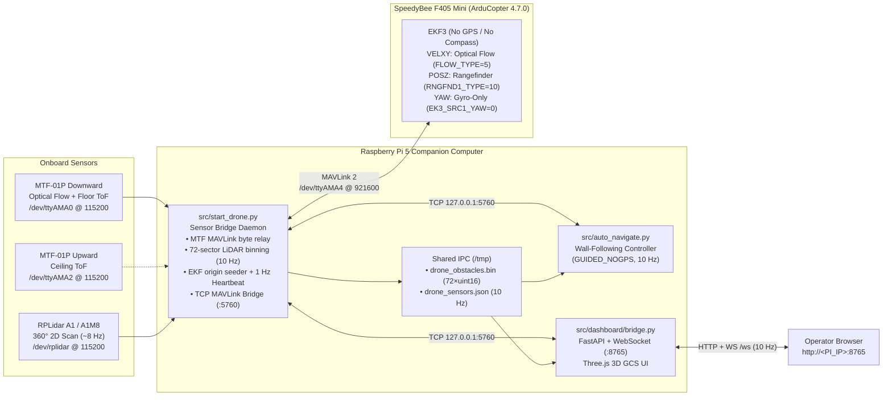

# Autonomous Indoor Drone — GPS-Denied Navigation & Web GCS (ROS-Less)

A lightweight, pure-Python autonomous indoor drone stack running on a **Raspberry Pi 5** (or Pi 4) and communicating with **ArduPilot (ArduCopter)** over raw **MAVLink 2** (`pymavlink`). Designed for **GPS-denied, compass-free, RC-optional indoor flight** using optical flow, Time-of-Flight (ToF) ranging, and 360° 2D LiDAR — with **zero ROS / MAVROS overhead**.

---

## Key Features

- **Pure Python + MAVLink 2 Architecture:** No ROS 2, MAVROS, or C++ build chains — fast boot, low CPU footprint on Raspberry Pi, and easy debugging.
- **GPS-Free & Compass-Free Indoor Flight:** Seeds a local EKF3 origin (`SET_GPS_GLOBAL_ORIGIN`) and fuses downward **MicoAir MTF-01P** optical flow (`OPTICAL_FLOW_RAD`) + ToF floor rangefinder (`DISTANCE_SENSOR`) with gyro yaw integration.
- **360° LiDAR Obstacle Avoidance & Wall-Following:** Streams 72-sector (5°/sector) **RPLidar A1/A1M8** scans via `OBSTACLE_DISTANCE` and runs a right-hand-rule wall-following state machine (`CRUISE` / `TURNING` / `STOP_SAFE`) in `GUIDED_NOGPS`.
- **Serial-to-TCP MAVLink Multiplexer:** `src/start_drone.py` owns the flight controller UART and exposes a local TCP MAVLink bridge (`127.0.0.1:5760`) plus shared IPC files (`/tmp/drone_obstacles.bin`, `/tmp/drone_sensors.json`) so navigation controllers and GCS dashboards can run concurrently.
- **Two Real-Time Web GCS Dashboards (FastAPI + WebSockets):**
  - **3D Telemetry & LiDAR Dashboard (`src/dashboard/bridge.py`):** Three.js 3D drone attitude/position viewer, live 360° LiDAR ring, sensor health, and flight controls.
  - **Minimal Auto-Loiter Control UI (`src/dashboard/drone_server.py`):** Mobile-friendly one-tap `GUIDED` takeoff with automatic transition to `LOITER` optical-flow hold at target altitude.
- **Dual Hardware Support:** Includes both the **SpeedyBee F405 Mini** headless autonomous stack and the **Cube Orange** RC-assisted Position-Hold + Proximity Avoidance stack (`src/position_hold/`).
- **Automated Firmware Parameter Uploader:** Type-safe MAVLink `PARAM_SET` uploader (`src/tools/upload_params.py`) with readback verification and EEPROM save/reboot — no Mission Planner required.

---

## System Architecture



> For the alternative **Cube Orange + RC Position-Hold** architecture (`src/position_hold/`), see [`docs/position_hold_guide.md`](docs/position_hold_guide.md).

---

## Hardware & Software Stack

### Hardware (Primary Autonomous Stack)

| Component | Connection / Protocol | Role |
|---|---|---|
| **SpeedyBee F405 Mini** | `SERIAL2` ↔ Pi `/dev/ttyAMA4` @ `921600` (MAVLink 2) | Flight controller (ArduCopter 4.6.2 / 4.7.0, Quad-X) |
| **Raspberry Pi 5** | 5.1–5.2 V, ≥ 5 A BEC on GPIO Pins 2 & 4 | Companion computer |
| **MicoAir MTF-01P (Downward)** | `/dev/ttyAMA0` (UART0) @ `115200` (`mav_apm` / MicoLink) | Optical flow velocity + floor ToF range |
| **MicoAir MTF-01P (Upward)** | `/dev/ttyAMA2` (UART2) @ `115200` | Ceiling clearance ToF range |
| **Slamtec RPLidar A1 / A1M8** | `/dev/rplidar` (USB udev symlink) @ `115200` | 360° 2D obstacle detection |

See [`hardware/README.md`](hardware/README.md) for full pinouts, UART overlays, udev rules, and the **Cube Orange** BOM/wiring.

### Software Requirements

- **OS:** Raspberry Pi OS (64-bit, Bookworm / Debian 12+) or Ubuntu 22.04/24.04
- **Python:** 3.10+ (tested on Python 3.12)
- **Firmware:** ArduCopter 4.6.2+ / 4.7.0
- **Python Libraries** (see [`requirements.txt`](requirements.txt)): `pymavlink`, `pyserial`, `rplidar-roboticia`, `numpy`, `fastapi`, `uvicorn[standard]`, `websockets`

---

## Repository Structure

```text
.
├── README.md                          # Project overview, architecture, setup & usage
├── requirements.txt                   # Unified Python dependencies
├── .gitignore                         # Ignores venvs, caches, build artifacts & flight logs
├── firmware_config/
│   └── ardupilot_params.param         # ArduCopter 4.7.0 parameters (GPS-free EKF3 + Optical Flow)
├── hardware/
│   └── README.md                      # BOM, GPIO/UART wiring pinouts, power notes & CAD placeholder
├── scripts/
│   ├── setup_autostart.sh             # RPi 5 systemd services + Wi-Fi AP hotspot + mDNS setup
│   └── setup_rpi_position_hold.sh     # One-time RPi setup for Cube Orange Position-Hold stack
├── docs/
│   ├── dashboard_overview.md          # Architecture & usage of both web GCS dashboards
│   ├── mtf01p_protocol.md             # MTF-01P serial protocol & binary frame parsing reference
│   └── position_hold_guide.md         # Complete Cube Orange + RC Position-Hold & Avoidance guide
└── src/
    ├── config.py                      # Central constants & env-var overrides (ports, rates, gains)
    ├── start_drone.py                 # Multi-threaded sensor bridge daemon + TCP MAVLink bridge
    ├── auto_navigate.py               # Autonomous arm/takeoff/wall-following controller
    ├── dashboard/
    │   ├── bridge.py                  # Full 3D GCS backend (FastAPI + WebSocket via TCP bridge)
    │   ├── index.html                 # Full 3D GCS frontend (Three.js + OrbitControls)
    │   ├── drone_server.py            # Standalone minimal Auto-Loiter web dashboard (direct UART)
    │   └── static/                    # Vendored Three.js r128 & OrbitControls assets
    ├── position_hold/
    │   ├── lidar_bridge.py            # Cube Orange RPLidar → OBSTACLE_DISTANCE MAVLink bridge
    │   ├── takeoff.py                 # Autonomous GUIDED takeoff → LOITER handoff
    │   ├── takeoff_avoidance_test.py  # Indoor SLIDE-mode avoidance test + live proximity monitor
    │   └── arm_disarm.py              # CLI & interactive arm/disarm/status utility
    └── tools/
        ├── upload_params.py           # Type-safe ArduPilot .param uploader over UART
        ├── check_params.py            # Search FC parameter names by keyword
        ├── mtf_raw.py                 # Raw MicoLink (0xEF) frame sniffer/decoder
        └── test_optical_flow.py       # Serial protocol auto-detector (MicoLink / MAVLink / MSP)
```

---

## Installation & Setup

### 1. Clone & Create Python Environment

```bash
git clone <YOUR_REPO_URL>
cd <REPO_DIR>

python3 -m venv .venv
source .venv/bin/activate
pip install --upgrade pip
pip install -r requirements.txt
```

### 2. Raspberry Pi 5 Hardware Preparation

1. **Enable hardware UARTs** in `/boot/firmware/config.txt`:
   ```ini
   dtoverlay=uart4
   dtoverlay=disable-bt
   dtoverlay=uart2
   ```
2. **Disable serial login console** via `sudo raspi-config` → *Interface Options* → *Serial Port* (Login shell: **No**, Hardware: **Yes**).
3. **Add persistent RPLidar udev symlink** (`/etc/udev/rules.d/99-rplidar.rules`):
   ```udev
   SUBSYSTEM=="tty", ATTRS{idVendor}=="10c4", ATTRS{idProduct}=="ea60", SYMLINK+="rplidar"
   ```
   Then reload: `sudo udevadm control --reload-rules && sudo udevadm trigger`.
4. **Grant serial permissions:** `sudo usermod -aG dialout $USER` and reboot.

### 3. Upload ArduPilot Parameters (SpeedyBee F405 Mini)

You can upload [`firmware_config/ardupilot_params.param`](firmware_config/ardupilot_params.param) directly from the Raspberry Pi (no Mission Planner needed):

```bash
# Dry-run to inspect parsed parameters
python3 src/tools/upload_params.py --dry-run

# Verify current FC params against file
python3 src/tools/upload_params.py --verify-only

# Upload, save to EEPROM, and reboot FC
python3 src/tools/upload_params.py --reboot
```

---

## Running the System

### A. Simulation (ArduPilot SITL — No Physical Hardware Required)

You can test the MAVLink bridge, autonomous navigation state machine, and web dashboards against **ArduPilot SITL**:

1. Start ArduCopter SITL (with optical flow / rangefinder enabled):
   ```bash
   sim_vehicle.py -v ArduCopter --console --map
   ```
2. Point the stack at SITL's TCP output port using environment variables:
   ```bash
   # Terminal 1 — Bridge daemon connected to SITL
   FC_SERIAL_PORT=tcp:127.0.0.1:5762 python3 src/start_drone.py

   # Terminal 2 — 3D Web GCS Dashboard (http://localhost:8765)
   python3 src/dashboard/bridge.py

   # Terminal 3 — Test mode switch / navigation controller
   python3 src/auto_navigate.py --mode-only --skip-ekf-check
   ```

> **Note:** When running the minimal dashboard (`src/dashboard/drone_server.py`) standalone against SITL, connect it directly:
> `FC_SERIAL_PORT=tcp:127.0.0.1:5762 python3 src/dashboard/drone_server.py`

### B. Physical Hardware Bringup (SpeedyBee F405 Mini + RPi 5)

> [!CAUTION]
> **Remove all propellers** before running your first bench, mode-switch, or arm test.

1. **Verify MTF-01P sensor protocol (optional diagnostic):**
   ```bash
   python3 src/tools/test_optical_flow.py --port /dev/ttyAMA0
   # If in MicoLink mode:
   python3 src/tools/mtf_raw.py --port /dev/ttyAMA0 --duration 10
   ```
2. **Start the sensor bridge daemon (Terminal 1):**
   ```bash
   source .venv/bin/activate
   python3 src/start_drone.py
   ```
3. **Launch the 3D Web GCS Dashboard (Terminal 2, optional):**
   ```bash
   python3 src/dashboard/bridge.py
   # Open http://<PI_IP>:8765 in a browser
   ```
4. **Progressive flight test sequence (Terminal 3):**
   ```bash
   # 1. Verify EKF + GUIDED_NOGPS mode switch (no arming)
   python3 src/auto_navigate.py --mode-only

   # 2. Verify arming only (PROPS OFF!)
   python3 src/auto_navigate.py --arm-only

   # 3. Full autonomous wall-following flight (auto-lands after 120 s or on Ctrl+C)
   python3 src/auto_navigate.py --max-runtime 120
   ```

#### Alternative: Standalone Minimal Auto-Loiter Dashboard
If you only need one-tap takeoff → `LOITER` optical-flow hover (without `start_drone.py` or LiDAR wall-following):
```bash
python3 src/dashboard/drone_server.py
```

#### Headless Auto-Start & Field Wi-Fi Hotspot (Systemd)
To auto-start `start_drone.py` and `dashboard/bridge.py` on boot and create an on-demand field Wi-Fi AP:
```bash
HOTSPOT_PASS="<your-strong-password>" sudo -E bash scripts/setup_autostart.sh
sudo drone-hotspot-on   # Activates AP; open http://10.42.0.1:8765
```

### C. Cube Orange Position-Hold Stack

For the Cube Orange + RC transmitter workflow, see [`docs/position_hold_guide.md`](docs/position_hold_guide.md) or run:
```bash
sudo bash scripts/setup_rpi_position_hold.sh
python3 src/position_hold/takeoff.py
```

---

## Configuration & Tuning

### Environment Variables

All serial devices, baud rates, and network ports can be overridden at runtime without editing source files:

| Variable | Default | Used By |
|---|---|---|
| `FC_SERIAL_PORT` | `/dev/ttyAMA4` (`/dev/ttyAMA0` in `position_hold`) | `config.py`, `upload_params.py`, `drone_server.py`, `position_hold/*` |
| `FC_BAUD_RATE` | `921600` | All FC scripts |
| `MTF_DOWN_PORT` / `MTF_UP_PORT` | `/dev/ttyAMA0` / `/dev/ttyAMA2` | `config.py`, `start_drone.py` |
| `RPLIDAR_PORT` | `/dev/rplidar` (`/dev/ttyUSB0` in `position_hold`) | `config.py`, `lidar_bridge.py` |
| `FC_BRIDGE_HOST` / `FC_BRIDGE_PORT` | `127.0.0.1` / `5760` | `start_drone.py`, `auto_navigate.py`, `dashboard/bridge.py` |
| `DASHBOARD_HOST` / `DASHBOARD_PORT` | `0.0.0.0` / `8765` | `dashboard/bridge.py`, `dashboard/drone_server.py` |

### Key Navigation & Flight Tuning (`src/config.py`)

| Parameter | Default | Description |
|---|---|---|
| `TAKEOFF_ALT_M` | `1.0 m` | Target autonomous hover altitude (`±0.10 m` tolerance) |
| `WALL_TARGET_DIST_M` | `0.60 m` | Desired right-wall standoff distance |
| `WALL_FOLLOW_SPEED_MS` | `0.35 m/s` | Forward cruise velocity in `CRUISE` state |
| `WALL_P_GAIN` | `0.8` | Proportional gain for lateral wall-distance correction (clamped to `±0.3 m/s`) |
| `FRONT_BRAKE_DIST_M` | `0.50 m` | Front cone (`±15°`) distance that triggers a 90° left turn |
| `TURN_RATE_DEG_S` | `40.0 °/s` | Yaw rate during 90° corner turns |
| `EKF_SOAK_S` | `8.0 s` | Continuous healthy EKF duration required before arming |
| `FLOW_QUALITY_MIN` | `50` | Minimum optical flow quality (`0–255`) |
| `CEILING_MIN_M` | `0.40 m` | Minimum upward ceiling clearance guard |

### Key ArduPilot Parameters (`firmware_config/ardupilot_params.param`)

| Parameter | Value | Purpose |
|---|---|---|
| `SERIAL2_PROTOCOL` / `SERIAL2_BAUD` | `2` / `921` | MAVLink 2 @ 921600 baud to RPi 5 |
| `GPS1_TYPE` / `EK3_GPS_CHECK` | `0` / `0` | Disable GPS and GPS pre-arm checks |
| `FLOW_TYPE` / `EK3_FLOW_USE` | `5` / `1` | MAVLink optical flow fusion in EKF3 |
| `RNGFND1_TYPE` / `RNGFND1_ORIENT` | `10` / `25` | MAVLink downward ToF rangefinder (`PITCH_270`) |
| `EK3_SRC1_POSXY` / `VELXY` / `POSZ` / `YAW` | `0` / `5` / `2` / `0` | Optical flow velocity + rangefinder altitude + gyro yaw |
| `COMPASS_USE` / `COMPASS_ENABLE` | `0` / `0` | Compass-free indoor operation |
| `AVOID_ENABLE` | `0` | Disabled on FC so `auto_navigate.py` owns avoidance |
| `ARMING_SKIPCHK` / `FS_THR_ENABLE` | `-1` / `0` | Headless RC-less arming (re-enable checks after initial testing!) |

---

## Safety Reminders

- `ARMING_SKIPCHK=-1` disables pre-arm safety checks for initial headless bench bringup. Re-enable selective checks once sensors are verified.
- Always test `--arm-only` with **propellers removed**.
- Press `Ctrl+C` in `auto_navigate.py` at any time to immediately hover, switch to `LAND`, and disarm.

---

## License

MIT License — see individual headers or add a `LICENSE` file before publishing.
